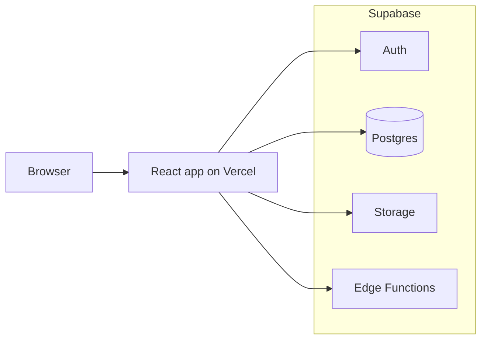
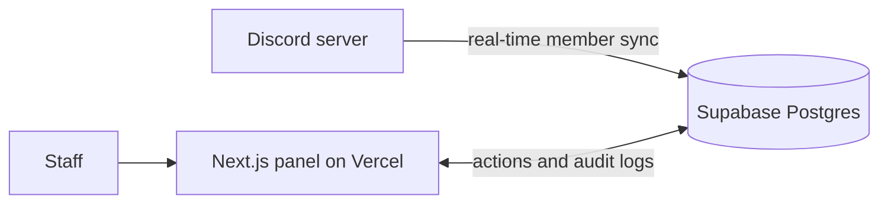

<picture>
  <source media="(prefers-color-scheme: dark)" srcset="assets/header-dark.svg">
  
</picture>

I've been building web apps for about three years, mostly React/Next.js and Supabase. I use AI tools (Claude, Codex, Gemini) heavily and say so. At school I'm learning C and C++ properly. The project repos are private; the apps are live, so click a project to open it.

<a href="https://ahikut.vercel.app/">
<picture>
  <source media="(prefers-color-scheme: dark)" srcset="assets/ahikut-dark.svg">
  
</picture>
</a>

How AHİKUT is built

A Vite + React single-page app that talks straight to Supabase. Postgres holds institutions, applications, auditor assignments, findings and certificates; scoring runs as a Postgres function. Evidence files go to Storage.

<a href="https://lutheus.vercel.app">
<picture>
  <source media="(prefers-color-scheme: dark)" srcset="assets/lutheus-dark.svg">
  
</picture>
</a>

How LUTHEUS is built

Next.js App Router on Vercel, Supabase behind it. The public page reads its live counts from a Next.js API route; staff sign in to reach the panel.

<picture>
  <source media="(prefers-color-scheme: dark)" srcset="assets/toolkit-dark.svg">
  
</picture>

<picture>
  <source media="(prefers-color-scheme: dark)" srcset="assets/activity-dark.svg">
  
</picture>

<a href="https://linkedin.com/in/kalpersener">LinkedIn</a> · <a href="https://leetcode.com/gearheadd">LeetCode</a>

