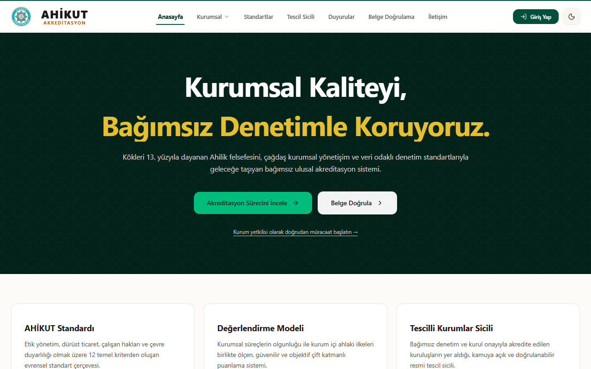
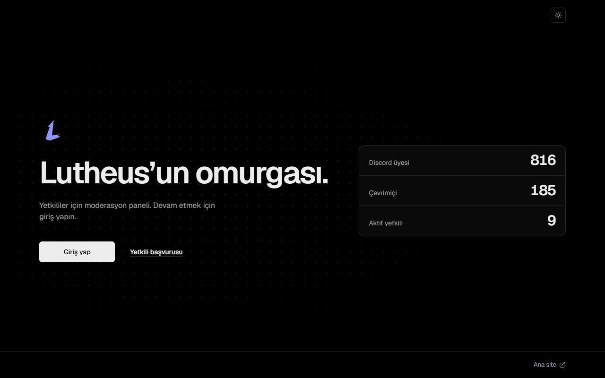

<picture>
  <source media="(prefers-color-scheme: dark)" srcset="assets/header-dark.svg">
  
</picture>

I've been building web apps for about three years, mostly with Next.js and Supabase. I use AI tools (Claude, Codex, Gemini) heavily and say so. At school I'm learning C and C++ properly.

## Projects

The repos are private. The apps are live; click a screenshot to open one.

<table>
  <tr>
    <td width="50%" valign="top">
      
      <h3><a href="https://ahikut.vercel.app/">AHİKUT</a></h3>
      
Certification and accreditation platform. Institutions, auditors, standards and compliance evidence in one place, with audit workflows that end in a report.

      
Next.js, TypeScript, Supabase, Postgres

    </td>
    <td width="50%" valign="top">
      
      <h3><a href="https://lutheus.vercel.app">LUTHEUS</a></h3>
      
Moderation panel for a Discord server's staff. Moderation actions and audit logs, real-time member sync and a dashboard. Its landing page shows the live counts.

      
TypeScript, React, Supabase, Postgres

    </td>
  </tr>
</table>

## Toolkit

  Daily 
  

  Comfortable 
  

  Learning 
  

## Activity

<picture>
  <source media="(prefers-color-scheme: dark)" srcset="https://streak-stats.demolab.com/?user=Gear2Head&hide_border=true&disable_animations=true&background=0D1117&stroke=30363D&ring=F78166&fire=F78166&currStreakLabel=F78166&currStreakNum=E6EDF3&sideNums=E6EDF3&sideLabels=8B949E&dates=8B949E">
  
</picture>

## Contact

[LinkedIn](https://linkedin.com/in/kalpersener) &nbsp;&nbsp; [LeetCode](https://leetcode.com/gearheadd)
