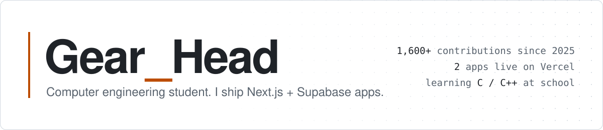
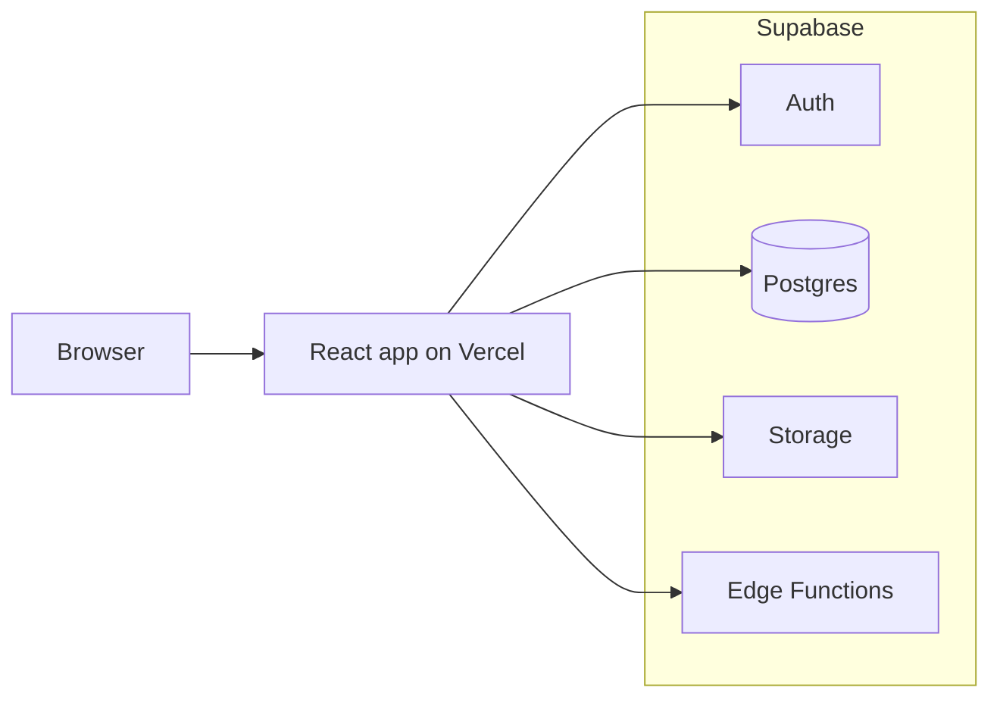
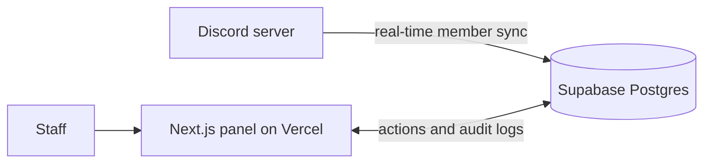

<picture>
  <source media="(prefers-color-scheme: dark)" srcset="assets/header-dark.svg">
  
</picture>

I've been building web apps for about three years, mostly with Next.js and Supabase. I use AI tools (Claude, Codex, Gemini) heavily and say so. At school I'm learning C and C++ properly.

## Projects

The repos are private. The apps are live; click a screenshot to open one.

<table>
<tr>
<td width="50%" valign="top">

<h3><a href="https://ahikut.vercel.app/">AHİKUT</a></h3>

Certification and accreditation platform. Institutions, auditors, standards and compliance evidence in one place, with audit workflows that end in a report.

React, TypeScript, Supabase, Postgres

How it's built

A single-page app that talks straight to Supabase. Postgres holds institutions, applications, auditor assignments, findings and certificates; scoring runs as a Postgres function. Evidence files go to Storage.

</td>
<td width="50%" valign="top">

<h3><a href="https://lutheus.vercel.app">LUTHEUS</a></h3>

Moderation panel for a Discord server's staff. Moderation actions and audit logs, real-time member sync and a dashboard. Its landing page shows the live counts.

TypeScript, React, Supabase, Postgres

How it's built

Next.js App Router on Vercel, Supabase behind it. The public page reads its live counts from a Next.js API route; staff sign in to reach the panel.

</td>
</tr>
</table>

## Toolkit

  Daily 
  

  Comfortable 
  

  Learning 
  

## Activity

<picture>
  <source media="(prefers-color-scheme: dark)" srcset="assets/activity-dark.svg">
  
</picture>

Redrawn every day from the GitHub API by <a href="scripts/build-cards.mjs">a script in this repo</a>.

## Contact

[LinkedIn](https://linkedin.com/in/kalpersener) &nbsp;&nbsp; [LeetCode](https://leetcode.com/gearheadd)
